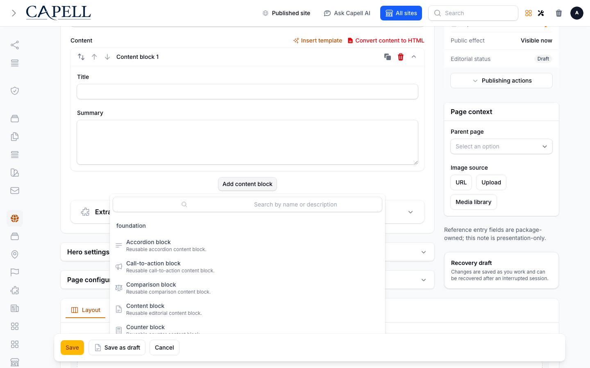
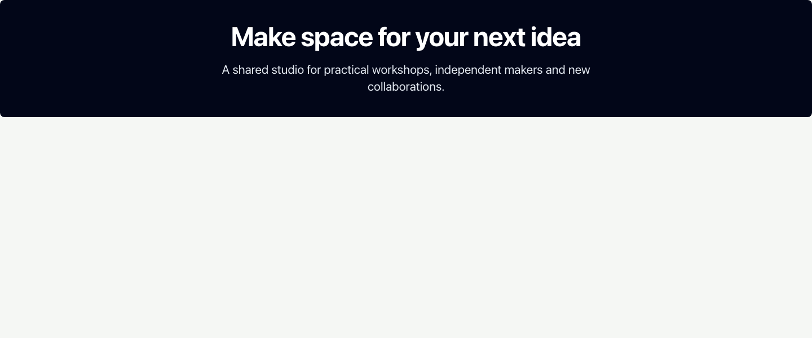

# Block Library

<!-- prettier-ignore-start -->

In the block picker on a page you are building, typing pricing finds a block with a field for each plan. Seventeen ready-made blocks are in the picker, from FAQ and pricing to team and timeline. A block belongs to the page you add it to, while a section from Content Sections is built once and shared across many pages.

Block Library arrives with Layout Builder, the page builder, which puts the blocks on public pages using Block Library's own templates. It has no screen or settings of its own, and its blocks appear in the page editor for anyone who can already edit the page.

Each block has a title and a short summary, and most have fields of their own, such as a list of questions or plans you can reorder and fold away. Rich text is cleaned, and links are limited to ordinary web, email and phone addresses, so a pasted link to anywhere else is dropped. Logo and team blocks take uploaded images, and a copied block gets its own set.

- **Price and availability:** Check current availability and price on the [Capell Marketplace listing](https://capell.app/marketplace/extensions/block-library).
- **Licence:** Check the licence terms on the [Capell Marketplace listing](https://capell.app/marketplace/extensions/block-library).
- **Requires:** `PHP ^8.4`, `capell-app/admin ^1.0.79`, `capell-app/core ^1.0.79`, `filament/forms ^5.7.6`, `lorisleiva/laravel-actions *`, `spatie/laravel-package-tools *`.
- **Install:** `composer require capell-app/block-library`.

## Quick Start

1. Install the package: `composer require capell-app/block-library`.
2. Verify the package provider and manifest contributions are registered in the host app.

## For Developers

BlockDefinitionProvider and FilamentBuilderBlock define the extension boundary, while the block and builder registries resolve definitions without hard-coding them into a consuming package.

## Configure

This extension works without configuration. There is nothing to set after install.

## Limits And Pitfalls

- Install the required Capell packages at the versions in `composer.json`: `capell-app/admin ^1.0.79`, `capell-app/core ^1.0.79`.
- Keep public Blade and cached HTML free of authoring markers, model IDs, permissions, signed editor URLs, and lazy database queries.
- Custom write integrations must preserve invalidation for `block-library` cache tags.

## Screens And Workflow

- Block Library blocks in the installed page editor picker (admin).
- Frontend hero block (frontend).
- Frontend features block (frontend).
- Frontend pricing block (frontend).

## Install Impact

- Required packages: `capell-app/admin`, `capell-app/core`.
- Admin navigation: no admin page or resource contribution is declared.
- Admin/editor extensions: none declared.
- Permissions: no package permission declarations or Shield gates detected; host access rules still apply.
- Public routes: none declared.
- Database changes: no package migrations declared.
- Config: no package config files.
- Settings: no package settings declared.
- Queues or schedules: none declared.
- Cache tags: `block-library`.
- Commands: none declared.

## Troubleshooting

| Symptom | Likely cause | Check | Fix |
| --- | --- | --- | --- |
| Package surface is missing after install | Provider or manifest is not loaded | Confirm `capell.json`, package `composer.json`, and provider registration | Reinstall the package, refresh Composer autoload, and clear host caches |
| Public output leaks unexpected state | Render data, cache variation, or authoring boundary has regressed | Check public Blade, cache tags, and public-output safety tests | Move data loading out of Blade and rerun the package public-output tests |

## Upgrading

No manual steps between minor versions.

Read [CHANGELOG.md](CHANGELOG.md) before upgrading.

## Next Steps

- [Package docs](docs/README.md)
- [Overview](docs/overview.md)
- [Worked extension examples](docs/extension-contracts.md)
- [Admin guide](docs/admin-guide.md)
- [Troubleshooting](#troubleshooting)
- [Developer reference](docs/reference.md)
- [Marketplace assets](docs/assets/marketplace/)
- [Capell content language plan](../../docs/CONTENT_LANGUAGE_PLAN.md)
- [Capell documentation design system](../../docs/DESIGN_SYSTEM.md)
- [Capell and package ERD notes](../../docs/erd/capell-and-package-erds.md)
- Related packages: [Content Sections](../content-sections/README.md), [Foundation Theme](../theme-foundation/README.md).

<!-- prettier-ignore-end -->
