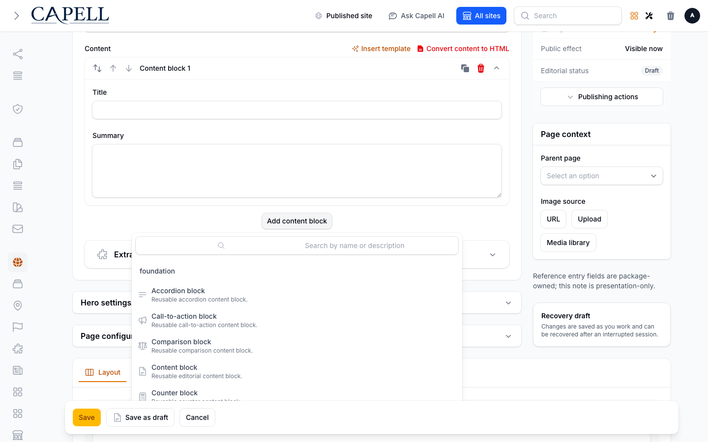
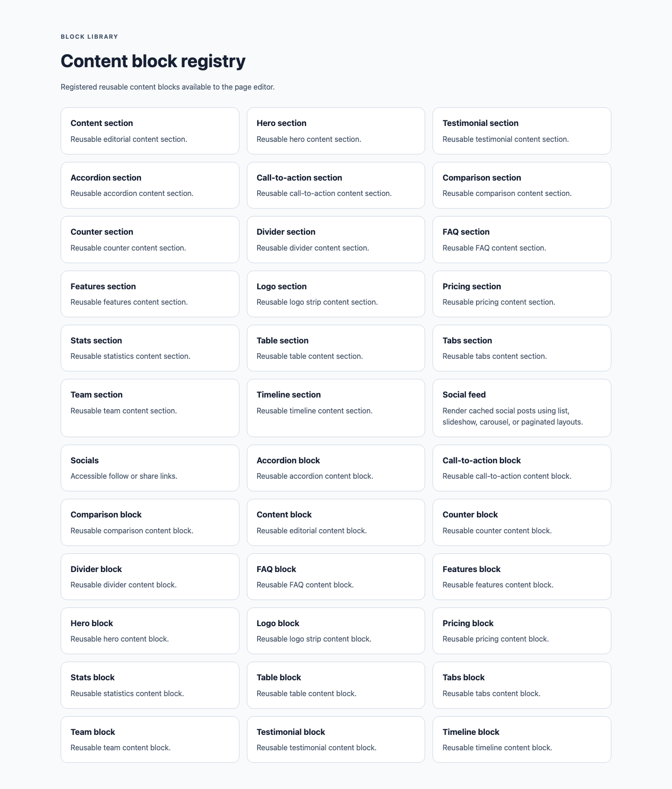

# Block Library

<!-- prettier-ignore-start -->

## What It Does

Block Library supplies typed, reusable content-block definitions and matching Filament Builder blocks for Capell content packages.

- **Price and availability:** Check current availability and price on the [Capell Marketplace listing](https://capell.app/extensions/block-library).
- **Licence:** Check the licence terms on the [Capell Marketplace listing](https://capell.app/extensions/block-library).
- **Requires:** `PHP ^8.4`, `capell-app/admin ^1.0.72`, `capell-app/core ^1.0.72`, `filament/forms ^5.7.6`, `lorisleiva/laravel-actions *`, `spatie/laravel-package-tools *`.
- **Install:** `composer require capell-app/block-library`.

The package has no standalone admin resource. Editors see its registered block choices inside Builder surfaces provided by consuming packages and can render their matching frontend views.

## Who It Is For

**For developers:** BlockDefinitionProvider and FilamentBuilderBlock define the extension boundary, while the block and builder registries resolve definitions without hard-coding them into a consuming package.

**For teams:** Editors can use the same supported block types across package-owned content forms instead of rebuilding common sections for each workflow.

## Quick Start

1. Install the package: `composer require capell-app/block-library`.
2. Verify the package provider and manifest contributions are registered in the host app.

## Configure

This extension works without configuration. There is nothing to set after install.

## Limits And Pitfalls

- Install the required Capell packages at the versions in `composer.json`: `capell-app/admin ^1.0.72`, `capell-app/core ^1.0.72`.
- Keep public Blade and cached HTML free of authoring markers, model IDs, permissions, signed editor URLs, and lazy database queries.
- Custom write integrations must preserve invalidation for `block-library` cache tags.

## Screens And Workflow

- Block Library blocks in the installed page editor picker (admin).
- List of content blocks available to editors (frontend).
- Content block asset settings (admin).
- Frontend hero block (frontend).
- Frontend features block (frontend).
- Frontend pricing block (frontend).
- Reusable block templates with the admin sidebar open (admin).

## Install Impact

- Required packages: `capell-app/admin`, `capell-app/core`.
- Admin navigation: no admin page or resource contribution is declared.
- Admin/editor extensions: none declared.
- Permissions: no package permission declarations or Shield gates detected; host access rules still apply.
- Public routes: none declared.
- Database changes: no package migrations declared.
- Config: no package config files.
- Settings: no package settings declared.
- Queues or schedules: none declared.
- Cache tags: `block-library`.
- Commands: none declared.

## Troubleshooting

| Symptom | Likely cause | Check | Fix |
| --- | --- | --- | --- |
| Package surface is missing after install | Provider or manifest is not loaded | Confirm `capell.json`, package `composer.json`, and provider registration | Reinstall the package, refresh Composer autoload, and clear host caches |
| Public output leaks unexpected state | Render data, cache variation, or authoring boundary has regressed | Check public Blade, cache tags, and public-output safety tests | Move data loading out of Blade and rerun the package public-output tests |

## Upgrading

No manual steps between minor versions.

Read [CHANGELOG.md](CHANGELOG.md) before upgrading.

## Next Steps

- [Package docs](docs/README.md)
- [Overview](docs/overview.md)
- [Worked extension examples](docs/extension-contracts.md)
- [Admin guide](docs/admin-guide.md)
- [Troubleshooting](#troubleshooting)
- [Developer reference](docs/reference.md)
- [Marketplace assets](docs/assets/marketplace/)
- [Capell content language plan](../../docs/CONTENT_LANGUAGE_PLAN.md)
- [Capell documentation design system](../../docs/DESIGN_SYSTEM.md)
- [Capell and package ERD notes](../../docs/erd/capell-and-package-erds.md)
- Related packages: [Content Sections](../content-sections/README.md), [Foundation Theme](../theme-foundation/README.md).

<!-- prettier-ignore-end -->
