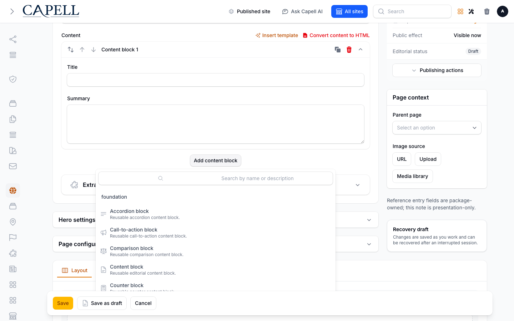

# Using Block Library

This guide is for editors who build pages with reusable blocks and owners deciding how a team uses them. Every step uses the labels you see on screen. Block Library has no screen of its own: its blocks appear in the block picker of the page editor.

## Using Block Library (editor how-to)

### How to add a block to a page

1. Open the page and go to its content or layout editor.
2. Open the block picker. Search by name or purpose, for example "pricing", "FAQ" or "CTA". Each block shows a label, a short description and an icon.
3. Choose the block, for example **Hero block**, **Pricing block** or **FAQ block**.
4. Fill in the fields it offers, such as **Heading**, **Description** and **Items**.
5. Save the page, then preview it to check how your theme presents the block.

### How to edit the content of a block

1. Open the page and find the block in the editor.
2. Change its fields. Repeating parts such as **Questions**, **Plans**, **Members** and **Milestones** have their own items that you can add, reorder or remove.
3. Save the page and preview it.

Rich text is cleaned before it is shown to visitors. Scripts, embedded frames and unsafe links are removed rather than published, so paste links and formatting rather than code.

### How to use images in a block

The **Logo block** and **Team block** use images you upload to the block itself.

1. In the block, upload your files under **Block images**.
2. Save the page so the images are stored with the block.
3. In each logo or team member, choose the uploaded file in **Image**.
4. If no image is chosen or a file is missing, the block shows the name or an initial instead.

Images belong to the language you are editing, so each translation keeps its own images. If you copy a logo or team block, the copy gets its own set of images; removing an image from the copy leaves the original unchanged.

### How to remove a block

1. Open the page and find the block in the editor.
2. Remove it with the block's remove control and save the page.

Removing a block does not delete its uploaded files straight away, because earlier versions of the page may still use them.

### Where blocks appear

Blocks appear on the public page wherever you place them in the page editor. Blocks added by other packages appear in the same picker only when those packages are installed.

## Rolling out Block Library (for owners)

### Turn on first

- Start with a few blocks that match your pages: **Hero block**, **Content block**, **Call-to-action block** and **FAQ block** cover most landing pages.

### Add when needed

| Need                         | Use                                       |
| ---------------------------- | ----------------------------------------- |
| Compare plans or products    | **Pricing block** or **Comparison block** |
| Show social proof            | **Testimonial block** or **Logo block**   |
| Introduce your people        | **Team block**                            |
| Explain a process or history | **Timeline block**                        |
| Answer common questions      | **FAQ block** or **Accordion block**      |

### Don't enable yet

- Don't build a page entirely from untested blocks. Preview the page on desktop and mobile after you change tabs, accordions, tables, images or calls to action.

### Who does what

| Role          | First useful step                                    |
| ------------- | ---------------------------------------------------- |
| Editor        | Add a block to a page, fill its fields and preview   |
| Site owner    | Decide which blocks each page type should use        |
| Administrator | Check the package is installed if blocks are missing |

## Troubleshooting for editors

| What you see                       | What it means                                          | What to do                                                               |
| ---------------------------------- | ------------------------------------------------------ | ------------------------------------------------------------------------ |
| A block is missing from the picker | The search is filtering it out, or it is not installed | Clear the search first; if it is still missing, ask an administrator     |
| A logo or team image does not show | No image was chosen, or the file is no longer there    | Upload it under **Block images**, save, then choose it in **Image**      |
| Formatting or a link disappeared   | Unsafe content is removed before publishing            | Re-enter the text with ordinary formatting and a normal web address      |
| The block looks wrong on the page  | Your theme styles blocks in its own way                | Preview the page and adjust the block's fields or ask for a theme change |
